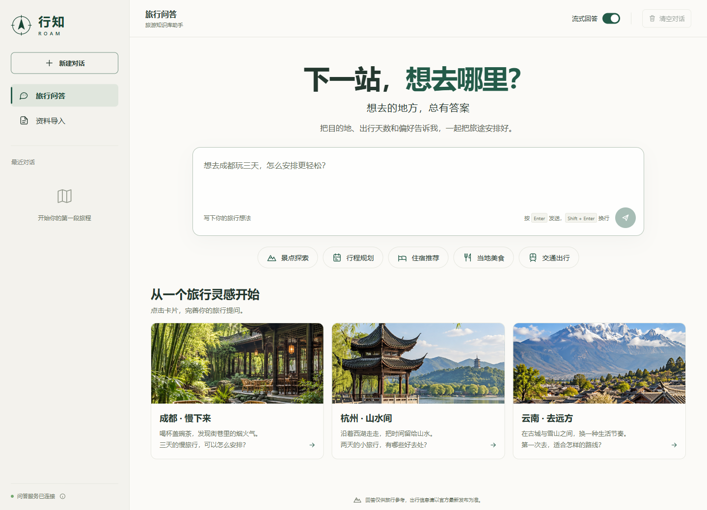
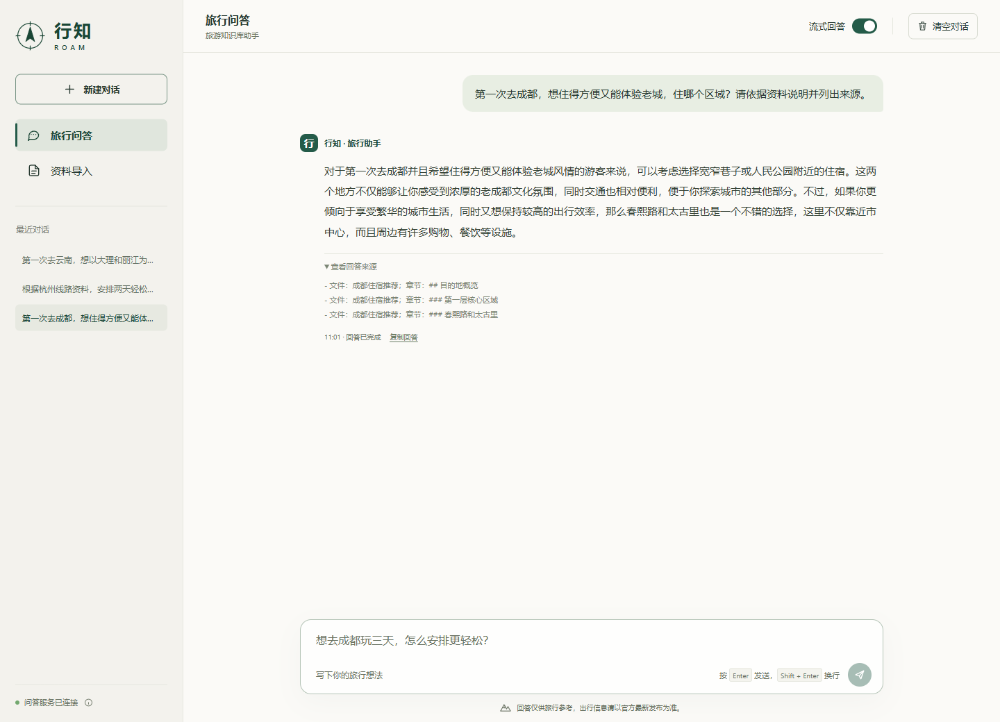
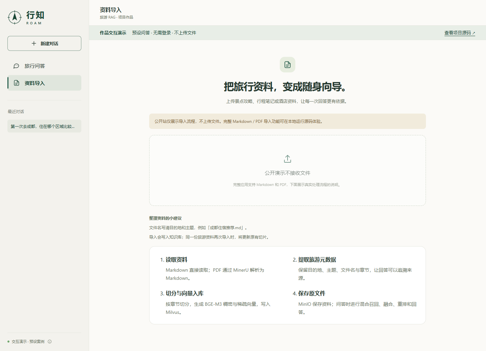
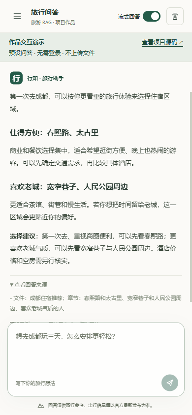

# 行知 ROAM · 旅游知识库助手

**把散落的旅游资料，变成有来源、可追问的旅行建议。**

[在线体验作品](https://2nott.github.io/knowledge-base-travel/) · [查看问答实例](#项目截图) · [本地启动完整应用](#启动前配置)

面向景点、线路、住宿、美食和交通五类旅行问题，使用 RAG 从旅游资料中检索依据，再生成带文件与章节来源的回答。前端支持流式阅读、会话切换、历史记录和资料导入。

> 在线站由 GitHub Pages 托管，不依赖开发者电脑，无需登录。它播放经过整理的**预设问答示例**，增量显示为前端演示效果；不提供实时模型推理、实时联网搜索或文件上传。完整后端功能保留在本仓库，可按下文部署。

## 项目看点

| 用户问题 | 项目处理方式 |
| --- | --- |
| 攻略分散、手动查找费时 | 导入 Markdown / PDF，按章节切分，保留旅游元数据 |
| 同一问题有多种说法 | BGE-M3 稠密 / 稀疏混合召回，加上 HyDE 补充召回 |
| 多路结果重复、相关性参差 | 两路本地结果经 RRF 融合，联网结果在 Reranker 阶段合并排序 |
| 回答难以核实 | 展示来源文件与章节，联网来源附真实网页链接 |
| 等待时看不到进度、追问丢失上下文 | SSE 增量输出、检索进度与 MongoDB 会话历史 |

**技术栈**：Python 3.11 · FastAPI · LangGraph · Milvus · BGE-M3 · Reranker · MongoDB · MinIO · 原生 JavaScript / CSS · Docker Compose

## 实现范围与验证

项目基于尚硅谷「掌柜智库 / 掌柜问数」课程工程进行旅游场景改造，保留课程的 RAG 技术路线。本仓库的改造重点是旅游元数据与检索过滤、旅游场景提示词、完整前端、Windows 启动和容器部署，以及运行兼容性修复；不将课程基础工程表述为从零原创。

- **资料规模**：本机已导入 30 份课程旅游资料，保存 1,153 个切片、30 份原始文件；这是验收规模，不是线上用户量。
- **真实流程**：验证过 Markdown 导入、单页 PDF 经 MinerU 解析入库、非流式 / SSE 问答、多轮追问、历史读取和 MCP 联网搜索。
- **问题修复**：处理复合城市字段导致的云南 / 大理 / 杭州漏检，并为旧 MCP 服务保留兼容协议约束。
- **自动检查**：25 项 Python 测试、4 项前端状态与演示路由测试通过；没有给出未经评测的准确率或业务增长数据。

## 项目截图

以下为应用实际渲染截图，非设计稿。前两张来自本地完整应用；后两张来自公开演示版本。旅行配图仅作灵感展示。

**首页：目的地灵感、问题分类与会话入口**



**真实问答：读取课程资料，展开文件与章节来源**



<details>
<summary>查看导入流程与手机端截图</summary>

**公开站的导入流程说明（不上传文件）**



**手机端交互演示**



</details>

## 在线演示的维护

站点源码在 `web/page/chat.html`、`web/assets/`，`scripts/build_demo.py` 将现有界面构建到 `docs/`。GitHub Pages 从 `main` 分支的 `/docs` 目录发布。

```bash
python scripts/build_demo.py
python -m http.server 8766 --directory docs
```

前端变更后重新构建并提交 `docs/`。构建仅复制白名单前端资源，不打包 `.env`、模型、数据库或本地对话。演示会话只保存在访问者自己的浏览器。

## 能力范围

- 导入景点攻略、旅游线路、酒店信息、美食推荐和交通指南
- 保存城市、内容类型、景点/线路/酒店/餐厅名称、来源文件和章节等旅游元数据
- 支持普通 BGE-M3 混合向量检索和 HyDE 混合向量检索
- 支持联网搜索作为补充召回路线
- 使用 RRF 融合两路本地向量召回，再把联网结果交给 Reranker 统一排序
- 支持多轮对话、流式输出、图片引用和历史记录

## 查询流程

```text
旅游问题预处理
  -> 普通混合向量检索
  -> HyDE 混合向量检索
  -> 联网搜索
  -> 多路结果合并
  -> RRF
  -> Reranker
  -> 旅游答案和来源
```

系统保留三路检索；当前 RRF 使用 `chunk_id` 融合两路 Milvus 结果，联网结果因为没有 Milvus 主键，在 Reranker 节点合并。

联网搜索是补充召回路线；当 MCP 搜索服务暂时不可用时，系统会保留两路本地检索并继续生成答案。

课程中的百炼搜索服务仍使用 `initialize` 协议，因此依赖约束为 `mcp<2`。升级 MCP 2 之前，需要先确认搜索服务支持新的 `server/discover` 协议。

## 启动前配置

Windows PowerShell：

```powershell
if (!(Test-Path .env)) { Copy-Item .env.example .env }
```

Linux/macOS：

```bash
cp .env.example .env
```

然后在 `.env` 中填写自己的 API Key、Milvus、MongoDB、MinIO 和模型路径。不要把 `.env` 提交到 GitHub。

## 基础设施

仓库提供 `compose.yaml`，按课程部署方案启动 Milvus 2.5.5、etcd、MinIO 和 MongoDB。所有端口仅绑定本机，数据保存在项目专用的 Docker 命名卷中，与其他项目隔离。

老师笔记中的 MinIO 镜像已无法拉取，官方归档二进制返回 HTTP 410。这里按 MinIO 官方发布说明，从固定版本 `RELEASE.2025-10-15T17-29-55Z` 源码构建；首次启动需要下载 Go 构建镜像和依赖，之后复用本地镜像。

```bash
docker compose up -d
docker compose ps
```

如果 Python API 和 Docker 服务在同一台机器，`.env` 可以使用 `localhost`。如果 API 在 Windows、Docker 服务在 Linux，则把服务地址改为 Linux 主机地址，例如：

```dotenv
MILVUS_URL=http://<LINUX_HOST_IP>:19530
MONGO_URL=mongodb://<LINUX_HOST_IP>:27017
MINIO_ENDPOINT=<LINUX_HOST_IP>:9000
```

MinIO 的签名请求依赖服务器时间。Linux 主机需要确认时间同步正常；CentOS 7 可执行：

```bash
yum install -y chrony
systemctl enable --now chronyd
chronyc sources -v
chronyc tracking
```

确认 `Reach` 大于 `0` 且 `Leap status` 为 `Normal` 后，再进行文件导入测试。

安装依赖：

```bash
uv sync --frozen
```

Windows 可双击 `启动项目.cmd`，或执行：

```powershell
.\start.ps1
```

脚本检查基础设施、等待数据库就绪、启动 API 并打开页面。再次执行会复用已运行的本项目服务。日志位于 `data/runtime/`。

手动启动（Windows/Linux/macOS）：

```bash
uv run uvicorn web.api.query_service:app --host 127.0.0.1 --port 8001
```

问答和导入共用 `8001`，避免与其他项目占用的 `8000` 冲突。启动后检查：

```bash
curl http://127.0.0.1:8001/health
curl http://127.0.0.1:8001/import-api/health
```

两个接口都返回 `ok: true` 表示 API 已启动；实际数据库连接与资料入库仍须通过导入、检索和历史记录验证。

页面地址：

- `http://127.0.0.1:8001/chat.html`：旅行问答，左侧「资料导入」上传文件
- `http://127.0.0.1:8001/docs`：查询 API；`/import-api/docs`：导入 API

需要单独部署导入 API 时，仍可运行 `uv run uvicorn web.api.import_service:app --host 127.0.0.1 --port 8002`。统一前端默认使用同一服务的 `/import-api`，无需再配置跨端口访问。

停止本项目基础设施可用 `docker compose stop`。不要执行 `docker compose down -v`，该命令会删除知识库、文件和聊天记录的数据卷。

## 导入旅游资料

上传 Markdown 或 PDF 文件。Markdown 建议在正文前增加元数据小节，例如：

```markdown
# 成都景点推荐
## 元数据
- 内容类型：景点介绍
- 城市：成都
- 景点名称：成都景点推荐
- 主题：亲子、城市漫游
```

系统会把元数据复制到每个切片，并写入专用的 `travel_chunks` 集合，不影响其他业务集合。

## 测试

当前仓库使用标准库 `unittest`：

Windows PowerShell：

```powershell
.\.venv\Scripts\python.exe -m unittest discover -s tests -v
```

Linux/macOS：

```bash
.venv/bin/python -m unittest discover -s tests -v
```

编译检查：

```bash
python -m compileall -q config processor utils web tests
```

测试覆盖旅游元数据解析、切片、向量文本上下文、多城市过滤、导入路由、查询图节点注册、前端资源路由和 MCP 旧协议握手。

前端状态检查：`node --test tests/test_chat_state.mjs`。

## 本机恢复验收（2026-10-17）

- 重建了项目专用的数据库和对象存储，导入课程中的 30 份旅游 Markdown，最终保存 1153 个切片。
- 真实接口已验证：Markdown 导入、单页 PDF 上传与 MinerU 解析入库、非流式问答、SSE 增量回答、多轮对话、MongoDB 历史读取、MCP 联网搜索。验收专用 PDF 已移出知识库，不混入课程资料。
- 已修复复合城市字段导致的漏检；“云南”“大理”“杭州”均能检索到相应的五类课程资料。
- 25 项 Python 测试和 4 项前端状态与演示路由测试通过；Chrome 中已验证真实问答、来源展示和会话切换。

旧虚拟机和旧聊天记录尚未找到可用备份，本次恢复使用新建的数据卷。原 `.env` 的本机备份位于 `data/runtime/original.env.bak`，该目录不会提交到 Git。

## GitHub 上传注意事项

- 提交 `.env.example`，不要提交 `.env`
- 不提交 `.venv`、模型缓存、临时文件和上传文件
- 只提交项目代码和经授权的示例数据，不提交原始资料目录
- 按 `.env.example` 创建本地 `.env`，运行配置保持单一清晰
